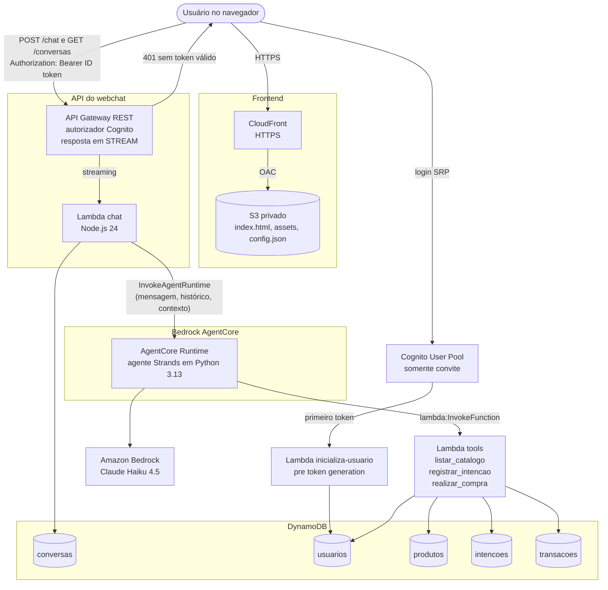

# Agente de pagamentos na AWS — Filipe Andrade

Desafio 1 da Sprint 2 (Pagamentos Agênticos). O chatbot da Fase 1 ([projeto original](https://github.com/RickyM7/Ollama-Chat-MCP-Payments/tree/3d09a7005722e30956f2799e1f3f10d89246ebf4)) agora roda na AWS: o login usa Amazon Cognito, o modelo do Ollama foi trocado pelo Claude Haiku 4.5 no Amazon Bedrock, o agente Strands roda no Bedrock AgentCore Runtime e toda a infraestrutura é definida em AWS CDK. As regras de negócio da Fase 1 (catálogo, intenção de compra, cartão ou Pix, limite por usuário e validação da intenção) foram mantidas.

| Item | Valor |
| --- | --- |
| Stack | `filipe-andrade-desafio-1` |
| Região | `us-east-1` (todos os recursos) |
| Modelo | Claude Haiku 4.5 (`us.anthropic.claude-haiku-4-5-20251001-v1:0`) |
| IaC | AWS CDK (TypeScript) em `infra/` |
| Deploy | `npm run deploy` dentro de `infra/` |

## Sumário

1. [Arquitetura implementada](#1-arquitetura-implementada)
2. [Deploy passo a passo](#2-deploy-passo-a-passo)
3. [Modelo do Bedrock](#3-modelo-do-bedrock)
4. [Modelagem do DynamoDB](#4-modelagem-do-dynamodb)
5. [Permissões IAM](#5-permissões-iam)
6. [Evidências](#6-evidências)
7. [Remoção dos recursos](#7-remoção-dos-recursos)
8. [Detalhes de implementação](#8-detalhes-de-implementação)
9. [Testes locais](#9-testes-locais)

## 1. Arquitetura implementada



### Fluxo de uma mensagem

1. O frontend (React + Vite, estático) é servido pelo CloudFront a partir de um bucket S3 privado, acessível apenas pela distribuição via Origin Access Control (OAC). A configuração (`config.json`, com URL da API e IDs do Cognito) é gerada pelo CDK no deploy.
2. O login usa o componente `Authenticator` do Amplify UI, com `hideSignUp`. O user pool só aceita usuários criados por administrador.
3. O frontend envia `POST /chat` com `Authorization: Bearer <ID token>`. O autorizador Cognito do API Gateway valida o token, inclusive a audiência do app client, e devolve `401` sem chegar à Lambda quando o token está ausente, expirado ou inválido.
4. A Lambda do chat obtém o `usuario_id` do claim `sub` do token, reserva a conversa no DynamoDB, carrega o histórico completo e invoca o AgentCore Runtime.
5. O agente Strands chama o Claude Haiku 4.5 e, quando necessário, a Lambda das ferramentas. O contexto autenticado (`usuario_id`, `sessao_id`) é repassado pelo backend; o modelo só preenche os argumentos das ferramentas.
6. O texto volta em streaming até o navegador (AgentCore → Lambda do chat → API Gateway em modo `STREAM`). Ao fim do turno, a Lambda salva as mensagens, incluindo chamadas e resultados das ferramentas.

### Variações em relação ao desenho de referência

| Decisão | Motivo |
| --- | --- |
| API Gateway **REST** em vez de HTTP API | O enunciado exige streaming ou WebSocket. A HTTP API não oferece streaming de resposta; a REST API oferece integração Lambda em modo `STREAM`, com limite de integração de até 15 minutos. O autorizador continua sendo o JWT do Cognito. [Documentação](https://docs.aws.amazon.com/apigateway/latest/developerguide/response-transfer-mode.html) |
| Uma única Lambda para as três ferramentas | Opção aceita pelo enunciado ("uma por tool, ou uma com roteamento interno"). A função recebe `ferramenta`, `contexto` e `argumentos`. |
| Lambda `inicializa-usuario` (gatilho *pre token generation* do Cognito) | Cria o registro do usuário na tabela `usuarios` com limite inicial de R$ 500 no primeiro login. A escrita é condicional e preserva o saldo nos logins seguintes. |
| Tabela `produtos` | O catálogo da Fase 1 fica no DynamoDB para que o estoque seja atualizado na mesma transação da compra. É carregado pelo CDK com inserções condicionais. |
| Ferramentas chamadas pelo agente com `lambda:InvokeFunction` | O AgentCore Gateway (MCP) é um extra opcional e não foi usado. |

## 2. Deploy passo a passo

### 2.1 Pré-requisitos

| Ferramenta | Versão | Verificação |
| --- | --- | --- |
| Node.js | 24.x | `node --version` |
| Python | 3.13 (instalado pelo uv) | `uv python install 3.13` |
| uv | qualquer recente | `uv --version` |
| AWS CLI | v2, 2.22 ou superior | `aws --version` |

Também é necessário:

- **Perfil SSO configurado** com região padrão `us-east-1`, conforme o tutorial [`login sso.md`](../../login%20sso.md) na raiz do repositório. Atenção: a *SSO region* pode ser outra, mas a *Default client Region* do perfil deve ser `us-east-1`.
- **Acesso ao Claude Haiku 4.5 no Bedrock em `us-east-1`.** No console, abra Bedrock → *Model catalog* → Claude Haiku 4.5 e preencha o formulário de caso de uso da Anthropic, se for solicitado. Envie uma mensagem de teste no *playground*: a primeira invocação habilita o modelo na conta, e a role do agente não tem permissões do AWS Marketplace para fazer isso sozinha.
- **Alerta no AWS Budgets** criado antes do primeiro deploy.

### 2.2 Autenticar o terminal

Em cada terminal novo (PowerShell):

```powershell
$env:AWS_PROFILE = "desafio-1"
aws sso login
aws sts get-caller-identity      # confirma a conta
aws configure get region         # deve responder us-east-1
```

### 2.3 Bootstrap do CDK (uma vez por conta e região)

Verifique se a conta já tem bootstrap em `us-east-1`:

```powershell
aws cloudformation describe-stacks --stack-name CDKToolkit --region us-east-1 --query "Stacks[0].StackStatus"
```

Se a stack não existir, rode na pasta `infra`:

```powershell
cd Desafio-1\filipe-andrade\infra
npm ci
npx cdk bootstrap aws://<ID_DA_CONTA>/us-east-1
```

### 2.4 Deploy (comando único)

```powershell
cd Desafio-1\filipe-andrade\infra
npm run deploy
```

Esse comando:

1. instala as dependências de `infra`, `tools` e `api` (`npm ci`);
2. valida o TypeScript e empacota as Lambdas com esbuild;
3. gera o pacote do agente (`agent/dist/agent.zip`) para Linux ARM64 com as dependências fixadas em `agent/uv.lock`;
4. instala e compila o frontend;
5. publica a stack com `cdk deploy`, incluindo o upload do frontend, a geração do `config.json` e a invalidação do cache do CloudFront.

O deploy não pede confirmação (`--require-approval never`). Para revisar as mudanças antes, rode `npx cdk diff`. Se o PowerShell bloquear o `npm` por *execution policy*, use `npm.cmd` e `npx.cmd`.

Ao final, a stack exibe os outputs:

| Output | Uso |
| --- | --- |
| `FrontendUrl` | Endereço do chat (`https://<id>.cloudfront.net`) |
| `ChatApiUrl` | URL base da API |
| `CognitoUserPoolId` / `CognitoUserPoolClientId` | Criação de usuários e testes |
| `AgentRuntimeArn`, `ChatFunctionArn`, `PaymentToolsArn`, `UsersTableName` | Diagnóstico |

### 2.5 Criar usuários (somente por convite)

O auto cadastro está desabilitado (`AllowAdminCreateUserOnly`). Usuários são criados pelo administrador, pelo console do Cognito ou pela CLI:

```powershell
aws cognito-idp admin-create-user --user-pool-id <CognitoUserPoolId> --username <email> `
  --user-attributes Name=email,Value=<email> Name=email_verified,Value=true
```

O Cognito envia um convite por e-mail com o usuário e uma senha temporária. No primeiro login, o usuário define uma nova senha. Cada usuário começa com limite simulado de R$ 500.

### 2.6 Problemas conhecidos

| Sintoma | Causa e solução |
| --- | --- |
| `Unable to locate credentials` | Terminal sem `AWS_PROFILE`. Repita o passo 2.2. Não use `aws login`. |
| `SSM parameter /cdk-bootstrap/hnb659fds/version not found` | Bootstrap ausente em `us-east-1`. Repita o passo 2.3 com a região explícita. |
| `AccessDenied` em `cloudfront:CreateOriginAccessControl` com *explicit deny in a service control policy* | Uma SCP da organização bloqueia a criação de OAC. Não é resolvível pela conta; é preciso pedir a liberação à coordenação. O rollback remove os recursos criados. |
| O chat responde com erro na primeira mensagem | Acesso ao modelo não habilitado. Repita o teste no *playground* do Bedrock (passo 2.1). |

## 3. Modelo do Bedrock

**Claude Haiku 4.5**, o modelo recomendado pelo enunciado: baixo custo, boa latência e bom desempenho em *tool calling*.

O Runtime usa o perfil de inferência `us.anthropic.claude-haiku-4-5-20251001-v1:0`, pelo qual o Haiku 4.5 é oferecido no Bedrock. A stack e a chamada ao Bedrock ficam em `us-east-1`; o perfil US pode processar a inferência em `us-east-1`, `us-east-2` ou `us-west-2`. A role do agente só pode invocar o modelo por meio desse perfil (condição `bedrock:InferenceProfileArn`).

## 4. Modelagem do DynamoDB

Todas as tabelas usam cobrança sob demanda (`PAY_PER_REQUEST`) e o prefixo `filipe-andrade-desafio-1-`. Valores monetários são guardados em centavos (inteiros) para evitar erros de arredondamento.

| Tabela | Chave | O que guarda | Quem acessa |
| --- | --- | --- | --- |
| `usuarios` | PK `usuario_id` (string, `sub` do Cognito) | `limite_centavos`: limite de gasto disponível | Lambda `inicializa-usuario` (cria), Lambda tools (lê e debita) |
| `conversas` | PK `conversa_id` (string), SK `ordem` (número) | Histórico de cada conversa (detalhes abaixo) | Lambda do chat |
| `produtos` | PK `id` (string, ex.: `prod_003`) | `nome`, `categoria`, `preco_centavos`, `moeda`, `estoque` | Lambda tools; carga inicial pelo CDK |
| `intencoes` | PK `intencao_id` (string, `int_<uuid>`) | `usuario_id`, `sessao_id`, `produto_id`, `quantidade`, `valor_centavos`, `moeda`, `status` (`pendente` ou `paga`), `expira_em_ms` (10 minutos) | Lambda tools |
| `transacoes` | PK `transacao_id` (string, `tx_<id da intenção>`) | `usuario_id`, `sessao_id`, `intencao_id`, `produto_id`, `quantidade`, `valor_centavos`, `moeda`, `metodo_pagamento`, `data` | Lambda tools |

**Conversas.** O `conversa_id` é o hash SHA-256 de `[sub, sessao_id]`, o que isola as conversas por usuário: um usuário não consegue ler a sessão de outro, mesmo conhecendo o `sessao_id`.

- O item `ordem = 0` controla o turno em andamento (`bloqueio`, `bloqueio_ate`) e guarda `ultimo_turno`. Uma segunda mensagem na mesma conversa enquanto a primeira é processada recebe `409`.
- Cada item `ordem = n` guarda um turno: `entrada` (mensagem do usuário), `resposta` (texto exibido) e `mensagens` (as mensagens completas do agente, incluindo chamadas e resultados das ferramentas). O histórico enviado ao agente a cada turno é a concatenação de `mensagens` de todos os turnos.

**Compra sem duplicidade.** `realizar_compra` grava tudo em um único `TransactWriteItems` com escritas condicionais:

| Item | Condição |
| --- | --- |
| `intencoes`: `status` → `paga` | `status = pendente`, mesmo usuário, mesma sessão e não expirada |
| `usuarios`: debita o limite | `limite_centavos` igual ao valor lido (sem alteração concorrente) |
| `produtos`: debita o estoque | `estoque >= quantidade` |
| `transacoes`: cria a transação | `transacao_id` ainda não existe |

Se a mesma chamada chegar duas vezes, a segunda falha na condição da intenção e retorna `INTENCAO_JA_PAGA`. O limite nunca é debitado duas vezes.

## 5. Permissões IAM

Todas as políticas estão no código (`infra/`). Nenhuma role da aplicação usa `"Action": "*"`, `"Resource": "*"` ou políticas gerenciadas amplas. Os curingas existentes são restritos a recursos do projeto: objetos do bucket do frontend (`<bucket>/*`), *log streams* dos grupos de log de cada função (`<grupo>:log-stream:*`) e o prefixo do Runtime (`filipe_andrade_desafio_1_agent-*`), cujos sufixos são gerados pelos serviços.

| Role | Pode | Não pode |
| --- | --- | --- |
| Lambda do chat | `Query` e `UpdateItem` na tabela `conversas`; `PutItem` nela somente dentro de transação; `bedrock-agentcore:InvokeAgentRuntime` no Runtime e no endpoint `DEFAULT`; logs no próprio grupo | Bedrock e as tabelas de pagamento (`usuarios`, `produtos`, `intencoes`, `transacoes`) |
| AgentCore Runtime | `bedrock:InvokeModelWithResponseStream` no perfil do Haiku 4.5 (e no modelo base somente via esse perfil); `lambda:InvokeFunction` na Lambda tools; `s3:GetObject` no ZIP do próprio agente; logs com o prefixo do Runtime | Acesso direto a qualquer tabela |
| Lambda tools | `Scan` em `produtos`; `GetItem` em `produtos`, `usuarios` e `intencoes`; `PutItem` em `intencoes`; `UpdateItem` em `produtos`, `usuarios` e `intencoes` e `PutItem` em `transacoes` **somente dentro de transação** (`dynamodb:EnclosingOperation = TransactWriteItems`); logs no próprio grupo | `conversas`, Bedrock, qualquer outra ação |
| Lambda `inicializa-usuario` | `PutItem` em `usuarios`; logs no próprio grupo | Demais tabelas |
| Lambda de carga do catálogo | `PutItem` em `produtos`; logs no próprio grupo | Demais tabelas |
| Lambda de publicação do frontend | Ler os dois ZIPs do deploy, gravar e remover objetos do bucket do frontend, invalidar somente a distribuição do projeto, logs no próprio grupo | Outros buckets e distribuições |
| Bucket do frontend (política de bucket) | `s3:GetObject` somente pelo serviço CloudFront com `AWS:SourceArn` igual à distribuição do projeto; nega qualquer acesso sem HTTPS | Acesso público (Block Public Access ativo) e *website hosting* |

A role do AgentCore só pode ser assumida pelo serviço `bedrock-agentcore.amazonaws.com` com as condições `aws:SourceAccount` (a própria conta) e `aws:SourceArn` (Runtimes com o prefixo do projeto). Ela não inclui `logs:DescribeLogGroups`, que exigiria `Resource: "*"`.

A role `cdk-hnb659fds-cfn-exec-role`, criada pelo bootstrap do CDK, é usada pelo CloudFormation para criar os recursos e não pertence à aplicação.

## 6. Evidências

> Pendente: as capturas serão adicionadas após o deploy. Os arquivos ficarão em `docs/evidencias/`.

| # | Cenário | Como reproduzir | Resultado esperado | Captura |
| --- | --- | --- | --- | --- |
| 1 | Login | Abrir o `FrontendUrl` e entrar com um usuário convidado | Tela de login sem opção de cadastro; chat acessível após o login | `docs/evidencias/01-login.png` |
| 2 | API sem token | `curl.exe -i -X POST "<ChatApiUrl>chat" -H "Content-Type: application/json" -d "{}"` | `HTTP/1.1 401` com `{"error":"Não autorizado."}` | `docs/evidencias/02-401-sem-token.png` |
| 2b | Token inválido | Mesmo comando com `-H "Authorization: Bearer invalido"` | `401` | `docs/evidencias/02b-401-token-invalido.png` |
| 3 | Compra com cartão | No chat: listar o catálogo, pedir 1 Fone Bluetooth (R$ 249,90) e pagar com cartão | `status: aprovado`, limite restante R$ 250,10 | `docs/evidencias/03-compra-cartao.png` |
| 4 | Compra com Pix | Nova conversa: pedir 1 Mouse Sem Fio (R$ 149,50) e pagar com Pix | `status: aprovado`, limite restante R$ 100,60 | `docs/evidencias/04-compra-pix.png` |
| 5 | Limite excedido | Nova conversa: pedir 1 PlayStation 5 (R$ 4.799,00) e escolher um método | Recusa com `LIMITE_EXCEDIDO`, explicada pelo agente | `docs/evidencias/05-limite-excedido.png` |
| 6 | `intencao_id` inválido | Pedir ao agente para pagar a intenção `int_falsa123` no Pix e/ou invocar a Lambda tools diretamente (abaixo) | Recusa com `INTENCAO_INVALIDA` | `docs/evidencias/06-intencao-invalida.png` |

Para o cenário 6, a Lambda pode ser invocada diretamente, mostrando que a validação é do backend e não depende do modelo. Crie um arquivo `evento.json`:

```json
{
  "ferramenta": "realizar_compra",
  "contexto": { "usuario_id": "<sub do usuário>", "sessao_id": "00000000-0000-0000-0000-000000000000" },
  "argumentos": { "intencao_id": "int_falsa123", "metodo_pagamento": "pix" }
}
```

```powershell
aws lambda invoke --function-name filipe-andrade-desafio-1-tools `
  --cli-binary-format raw-in-base64-out --payload file://evento.json resposta.json
Get-Content resposta.json
```

Resultado esperado: `{"status":"recusado","erro":"INTENCAO_INVALIDA","mensagem":"A intenção informada não é válida para esta sessão."}`.

## 7. Remoção dos recursos

Após a correção, destrua a stack:

```powershell
cd Desafio-1\filipe-andrade\infra
npx cdk destroy
```

A stack remove automaticamente as tabelas, o user pool, as Lambdas e seus grupos de log, a API, o AgentCore Runtime, a distribuição do CloudFront e o bucket do frontend (os arquivos são apagados pelo próprio recurso de publicação antes da exclusão do bucket).

Depois, confira no console (`us-east-1`) e remova o que tiver ficado fora da stack:

| Recurso | Por que fica | Como remover |
| --- | --- | --- |
| Grupos de log `/aws/bedrock-agentcore/runtimes/filipe_andrade_desafio_1_agent-*` | Criados pelo próprio AgentCore, fora do CloudFormation | CloudWatch → *Log groups* → excluir, ou `aws logs delete-log-group --log-group-name <nome>` |
| Bucket do frontend (só se a remoção falhar) | Um bucket com objetos não é excluído | Esvaziar e excluir o bucket no console do S3 |
| Bootstrap do CDK (`CDKToolkit` e bucket `cdk-hnb659fds-assets-<conta>-us-east-1`) | Criado pelo `cdk bootstrap`, fora da stack | Se nenhuma outra stack CDK usar a conta: esvaziar o bucket de assets e excluir a stack `CDKToolkit` no CloudFormation |

O agente é publicado como pacote ZIP (*direct code deploy*), então não há imagens no Amazon ECR.

## 8. Detalhes de implementação

### Estrutura

```
Desafio-1/filipe-andrade/
├── frontend/   React + Vite, Amplify Authenticator, leitura do streaming
├── api/        Lambda do chat (streaming, conversas) e Lambda inicializa-usuario
├── agent/      Agente Strands (app.py) e ferramentas que invocam a Lambda tools
├── tools/      Lambda das três ferramentas de pagamento
└── infra/      Stack CDK
```

### Contratos da API

| Operação | Contrato |
| --- | --- |
| `POST /chat` | Corpo: `sessao_id` (UUID) e `mensagem` (até 4.000 caracteres). Resposta em NDJSON: trechos `{"message":{"role":"assistant","content":"..."}}` e um evento final `{"done":true}`. Uma conversa com turno em andamento recebe `409`. |
| `GET /conversas/{sessao_id}` | Mensagens públicas (usuário e assistente) dos turnos concluídos da sessão do usuário autenticado. |

A Lambda do chat tem timeout de 90 segundos, e a integração do API Gateway, 95 segundos. Os dois valores ficam dentro do limite permitido em modo streaming.

### Agente

O entrypoint `agent/app.py` usa o SDK do AgentCore. A Lambda do chat envia `mensagem`, `historico` (completo, lido do banco) e `contexto` (`usuario_id` e `sessao_id`). O agente responde por SSE com eventos `texto`, `erro` e `fim`; o evento `fim` carrega as mensagens do turno para que a Lambda as persista.

As sessões ociosas do Runtime encerram após 5 minutos (máximo de 1 hora por sessão). O histórico continua no DynamoDB, então uma conversa retomada depois disso segue normalmente.

### Ferramentas e regras de negócio

Os contratos de argumentos, retornos e códigos de erro são os da Fase 1 (`INTENCAO_INVALIDA`, `INTENCAO_EXPIRADA`, `INTENCAO_JA_PAGA`, `LIMITE_EXCEDIDO`, `METODO_INVALIDO`, além de `PRODUTO_INVALIDO`, `QUANTIDADE_INVALIDA` e `ESTOQUE_INSUFICIENTE` em `registrar_intencao`).

| Regra | Como é garantida |
| --- | --- |
| `usuario_id` vem da sessão autenticada | Lido do `sub` do token pela Lambda do chat e repassado como `contexto`. As ferramentas expostas ao modelo não têm esse parâmetro. |
| Valor vem da intenção registrada | `realizar_compra` não recebe valor; usa `valor_centavos` salvo em `intencoes`, calculado pelo backend a partir do catálogo. |
| Só intenções criadas pelo backend, do usuário e não pagas | A intenção precisa existir na tabela, pertencer ao mesmo usuário e à mesma sessão, estar `pendente` e dentro da validade. |
| Sem duplicidade | Transação condicional descrita na seção 4. |
| Erros compreensíveis | As ferramentas retornam `status: recusado` com uma mensagem legível; falhas de infraestrutura chegam ao usuário como mensagens genéricas, sem stack traces. |

## 9. Testes locais

| Pasta | Comando | Requisito | O que cobre |
| --- | --- | --- | --- |
| `agent` | `uv sync --locked` e `uv run --locked python -m unittest discover -s tests -v` | Python 3.13 e uv | Agente Strands com respostas simuladas do modelo e da Lambda |
| `tools` | `npm ci` e `npm test` | [DynamoDB Local](https://docs.aws.amazon.com/amazondynamodb/latest/developerguide/DynamoDBLocal.DownloadingAndRunning.html) na porta 8000 (ou `DYNAMODB_LOCAL_PORT`) | Regras de compra, validação da intenção, limite e concorrência |
| `api` | `npm ci` e `npm test` | DynamoDB Local | Streaming, persistência, isolamento por usuário, chamadas simultâneas e criação do perfil |
| `frontend` | `npm ci` e `npm run test:e2e` | Microsoft Edge (Playwright) | Login sem cadastro público, streaming, recuperação do histórico e interrupções |
| `infra` | `npm run setup` e `npm run synth` | Python 3.13 e uv | Compila tudo e gera o template em `infra/cdk.out` sem criar recursos |
